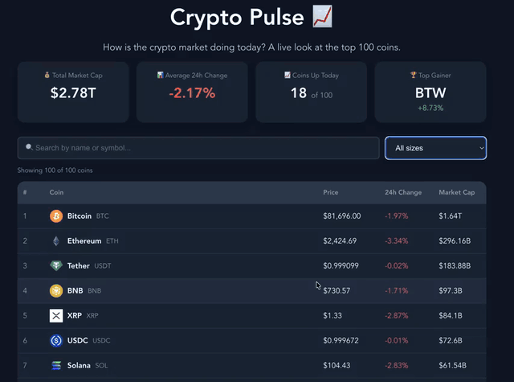

# Web Development Project 5 - *Crypto Pulse*

Submitted by: **Austin Stanley Hinson**

This web app: **A data dashboard that gives a live look at the top 100 cryptocurrencies, using the CoinGecko API. Each row shows a coin's rank, icon, name, symbol, price, 24 hour price change, and market cap. Summary cards at the top show the total market cap, the average 24 hour change, how many coins went up today, and the biggest gainer. Users can search for a coin by name or symbol and filter the list by market cap size (large, mid, or small cap) and by a price range they type in.**

Time spent: **5** hours spent in total

## Required Features

The following **required** functionality is completed:

- [x] **The site has a dashboard displaying a list of data fetched using an API call**
  - The dashboard should display at least 10 unique items, one per row
  - The dashboard includes at least two features in each row
- [x] **`useEffect` React hook and `async`/`await` are used**
- [x] **The app dashboard includes at least three summary statistics about the data**
  - The app dashboard includes at least three summary statistics about the data, such as:
    - Total market cap of all 100 coins
    - Average 24 hour price change
    - Number of coins that went up in price today
    - The top gainer of the day
- [x] **A search bar allows the user to search for an item in the fetched data**
  - The search bar **correctly** filters items in the list, only displaying items matching the search query
  - The list of results dynamically updates as the user types into the search bar
- [x] **An additional filter allows the user to restrict displayed items by specified categories**
  - The filter restricts items in the list using a **different attribute** than the search bar
  - The filter **correctly** filters items in the list, only displaying items matching the filter attribute in the dashboard
  - The dashboard list dynamically updates as the user adjusts the filter

The following **optional** features are implemented:

- [x] Multiple filters can be applied simultaneously
  - The search bar, market cap size filter, and price range all work together, e.g. searching `eth` while showing only large cap coins under $5,000
- [x] Filters use different input types
  - e.g., a text input, a dropdown or radio selection, and/or a slider
  - The search is a text input, the size filter is a dropdown menu, and the price range uses number inputs
- [x] User can enter specific bounds for filter values
  - Users can type a minimum and/or maximum price, and only coins priced between them are shown

The following **additional** features are implemented:

* [x] A "Showing 14 of 100 coins" counter updates as the search and filter change
* [x] A message appears when no coins match the search and filters
* [x] The 24 hour change is green when a coin went up and red when it went down
* [x] Prices are formatted for their size, so `$81,696.00` gets two decimal places and very small prices like `$0.00915659` keep enough decimals to be useful
* [x] Large numbers are shortened, so a market cap shows as `$1.64T` or `$987M`
* [x] Search ignores uppercase and lowercase, so `btc`, `BTC`, and `Bitcoin` all find Bitcoin
* [x] The API key is kept in a `.env.local` file so it isn't committed to GitHub

## Video Walkthrough

Here's a walkthrough of implemented required features:

<!-- Replace this with whatever GIF tool you used! -->
GIF created with the macOS Screenshot tool (Cmd+Shift+5) and converted to a GIF  
<!-- Recommended tools:
[Kap](https://getkap.co/) for macOS
[ScreenToGif](https://www.screentogif.com/) for Windows
[peek](https://github.com/phw/peek) for Linux. -->

## Notes

One challenge was showing prices in a readable way. Bitcoin is worth tens of thousands of dollars, but some coins are worth a tiny fraction of a cent, so rounding every price to two decimal places would show many coins as `$0.00`. The app gives prices under $1 more decimal places, and shortens big numbers like market caps into `$1.64T` or `$987M`. Another challenge was choosing categories for the filter. CoinGecko doesn't give each coin a simple category, so I grouped coins by market cap into large (over $10 billion), mid ($1 billion to $10 billion), and small (under $1 billion), which splits the top 100 coins into groups that are all worth looking at. Making the search and filter work together was easier than expected, since one `.filter()` can check both at once.

## License

    Copyright 2026 Austin Stanley Hinson

    Licensed under the Apache License, Version 2.0 (the "License");
    you may not use this file except in compliance with the License.
    You may obtain a copy of the License at

        http://www.apache.org/licenses/LICENSE-2.0

    Unless required by applicable law or agreed to in writing, software
    distributed under the License is distributed on an "AS IS" BASIS,
    WITHOUT WARRANTIES OR CONDITIONS OF ANY KIND, either express or implied.
    See the License for the specific language governing permissions and
    limitations under the License.
